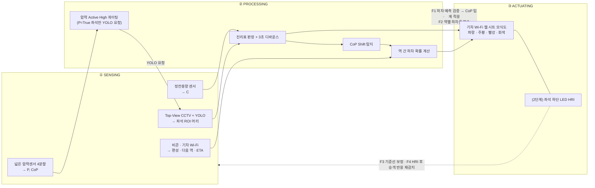

# Ⅲ-3. 공정 방법

> 담당: 함준석 (총괄 PM · 기술 공정 설계)
> 모든 수치·규칙은 저장소의 `c/jarikok.c` 와 1:1로 대응하며, `make test` 로 검증된다.

## 개요 — 감지(Sensing) · 연산(Processing) · 안내(Actuating) 폐루프(Closed-Loop) 구조

자리콕 웹은 대경선 2량 1편성(총 296명 = 좌석 78석 + 입석 218명)의 **좌석 78석 모두**를 1초 주기로 다음 순서에 따라 처리한다.

---

## 1. Sensing 단계 — "무엇이, 어디에, 어떤 자세로 있는가"

| 센서 | 설치 위치 | 출력 | 역할 |
|---|---|---|---|
| ① 넓은 압력 센서 (4분할: 앞왼·앞오·뒤왼·뒤오) | 좌석 쿠션 아래 | 하중 합계(kg), 무게중심 CoP | 무언가 올라가 있는가 + 앉은 자세 |
| ② 정전용량 센서 (전도성 전극) | 좌석 커버 안쪽 | 기준선 대비 증가량 ΔC(pF) | 그것이 **사람(인체 유전율)** 인가 |
| ③ Top-View CCTV + YOLO 머리 추적 | 객실 천장 | 좌석 박스(ROI) 안 머리 수, 머리 높이 변화 | 사람의 머리가 **어느 좌석 위에** 있는가 |
| ④ 비콘(Beacon)·기차 Wi-Fi | 객실 | 편성 번호, 다음 역, 도착까지 남은 시간(ETA) | 몇 번 열차의 몇 호차인가, 역에 가까운가 |

- **압력 이진화(정논리, Active High)**: 4분할 하중 합계 W ≥ 5 kg → **P = True(1)**.
- **정전용량 이진화**: ΔC = (측정값 − 빈 좌석 기준선) ≥ 3 pF → **C = True(1)**.
- **무게중심(CoP)**: 앞쪽 하중을 F, 뒤쪽 하중을 R 이라 할 때

  CoP_y = (F − R) / (F + R)  (앞 끝 = +1, 뒤 끝 = −1)

- **개인정보 보호**: CCTV 영상은 얼굴이 아닌 **위쪽(Top-View)에서 본 머리 위치 좌표만** 사용하며, 영상 자체는 저장·전송하지 않는다.

## 2. Processing 단계 — "그래서 이 자리는 어떤 자리인가"

### 2-1. 압력 Active High 게이팅 (연산 효율)
압력이 True 인 좌석에 대해서만 CCTV 영상에서 그 좌석 구역을 박스(Boxing) 처리해 YOLO 머리 추적을 요청한다. 빈 좌석에는 인공지능 연산을 하지 않으므로 78석 전체를 매번 분석하는 방식보다 연산량이 줄어든다. 압력이 False 인 좌석에 들어온 YOLO 결과는 받지 않는다.

### 2-2. 압력·정전용량 진리표

| 압력 P | 정전용량 C | ROI 머리 | 옆자리 머리 | 판정 | 웹 표시 |
|:-:|:-:|:-:|:-:|---|---|
| 0 | 0 | (미실행) | – | 빈자리 | 🟦 파랑 |
| 0 | 1 | (미실행) | – | 빈자리 (손·옷 스침 노이즈) | 🟦 파랑 |
| 1 | 1 | 있음 | – | **사람 착석** | ⬜ 회색 |
| 1 | 0 | 있음 | – | 사람 착석 (두꺼운 외투로 C 약화 → YOLO 가 보정) | ⬜ 회색 |
| 1 | 1 | 없음 | 있음 | **2칸 차지** (몸은 여기, 머리는 옆자리) | 🟥 빨강 |
| 1 | 1 | 없음 | 없음 | 사람 착석 (머리 가림 — 두 센서 모두 사람) | ⬜ 회색 |
| 1 | 0 | 없음 | – | **가방(짐)만 놓인 자리** | 🟥 빨강 |

핵심은 과제에서 정한 두 줄이다. **압력 True + 정전용량 True = 실제 사람**, **압력 True + 정전용량 False = 무거운 가방이 놓인 비매너 자리**. YOLO 머리 추적은 이 두 줄의 예외(두꺼운 외투, 2칸 차지)를 가려내는 교차 검증에 쓰인다.

### 2-3. 3초 디바운스
열차가 흔들리거나 승객이 잠깐 들썩이면 센서 값이 순간적으로 바뀐다. 같은 판정이 **3주기(3초) 연속**일 때만 상태를 확정하여 웹 화면이 깜빡이지 않게 한다.

### 2-4. CoP Shift Detection (무게중심 이동 탐지)
승객은 내리기 직전 엉덩이를 좌석 앞쪽으로 옮긴다. 사람마다 앉는 자세가 다르므로
1. 착석 확정 후 역에서 먼 구간에서 **5초 동안 개인별 기준 자세(CoP_base)** 를 학습하고,
2. 다음 역 도착 **90초 전부터** ΔCoP = CoP_y − CoP_base 가 임계값 θ(초기 0.30) 이상이면 "전방 이동"으로 본다.
3. 보조 증거로 YOLO 머리 높이가 0.10 이상 올라가면 "머리 상승"으로 본다.

### 2-5. 역 간 하차 확률 계산
역마다 내리는 사람의 비율(사전확률 r_역)이 다르므로, 같은 자세 변화라도 역에 따라 다르게 해석한다.

  logit(p) = logit(r_역) + 3.0·[CoP 전방 이동] + 1.5·[머리 상승] − 0.5·[역 근접인데 아무 징후 없음]

- 역에서 멀면(ETA > 90초) 증거를 쓰지 않고 p = r_역.
- 종착역(경산) 접근 시 p = 1.
- **p ≥ 0.70 이면 "곧 내릴 자리"** 로 표시하고, 열차가 그 역을 출발할 때까지 유지한다.

| 상황 | 계산 | 결과 |
|---|---|---|
| 동대구(r=0.45) 접근 + CoP 전방 이동 | logit(0.45)+3.0 = 2.80 | p ≈ 0.94 → 곧 내릴 자리 |
| 사곡(r=0.08) 접근 + CoP 전방 이동만 | logit(0.08)+3.0 = 0.56 | p ≈ 0.64 → 보류 |
| 사곡 접근 + CoP 전방 이동 + 머리 상승 | 0.56+1.5 = 2.06 | p ≈ 0.89 → 곧 내릴 자리 |

이 확률을 착석 좌석 전체에 더하면 **"다음 역에서 생길 빈자리 수(기대값)"** 가 되고, 칸별로 (빈자리 + 하차 확률 합)이 큰 칸을 **추천 칸**으로 안내한다. 좌석이 모두 찬 출퇴근 시간에도 입석 승객이 어디에 서 있으면 좋을지 알 수 있다.

## 3. Actuating 단계 — "승객에게 어떻게 알려줄 것인가"

1. **기차 Wi-Fi 웹(1단계)**: 비콘과 Wi-Fi 로 편성·호차를 자동 인식하여, 앱 설치 없이 **C 로직 + HTML** 기반의 웹 화면이 바로 열린다. 열차 내부를 모식화한 시트 그림 위에
   - 🟦 **파랑 — 현재 빈 좌석**
   - 🟧 **주황 — 곧 내릴 하차 예정 좌석**
   - 🟥 **빨강 — 가방 적재 및 2칸 차지 좌석**
   - ⬜ 회색 — 일반 착석
   을 실시간으로 포인팅하고, 다음 역 예상 빈자리 수와 추천 칸을 함께 보여준다.
2. **좌석 하단 LED 스트립(2단계 확장, HRI)**: 같은 판정 결과를 LED 색으로 출력한다(빈자리 파랑). 가방·2칸 차지가 **60초 이상** 계속되고 그 칸의 빈자리가 **2석 이하**로 붐비면 빨간 LED 를 점멸시켜 자리 정리를 유도한다.

## 4. 폐루프(Closed-Loop) 피드백 — 운행할수록 정확해지는 구조

안내(Actuating) 결과가 다시 감지·연산 단계로 되돌아가 시스템을 보정한다.

| 번호 | 피드백 | 방법 |
|---|---|---|
| F1 | 하차 예측 검증 → CoP 임계값 적응 | 역 도착 시 예측을 기록하고, 출발 시 실제로 비었는지 비교. 적중 θ −0.002, 놓침 θ −0.004, 오경보 θ +0.02 (0.20 ~ 0.50 범위) |
| F2 | 역별 하차율 학습 | r_역 ← 0.9·r_역 + 0.1·(그 역에서 실제로 비워진 좌석 비율) |
| F3 | 정전용량 기준선 보정 | 빈 좌석으로 확정된 동안 기준선을 측정값 쪽으로 천천히 이동(온도·습도 드리프트 제거) |
| F4 | HRI 반응 재감지 | LED 경고 후 승객이 가방을 치우면 압력이 사라지고, 다음 주기에 그 자리는 다시 파랑(빈자리)으로 표시 |
